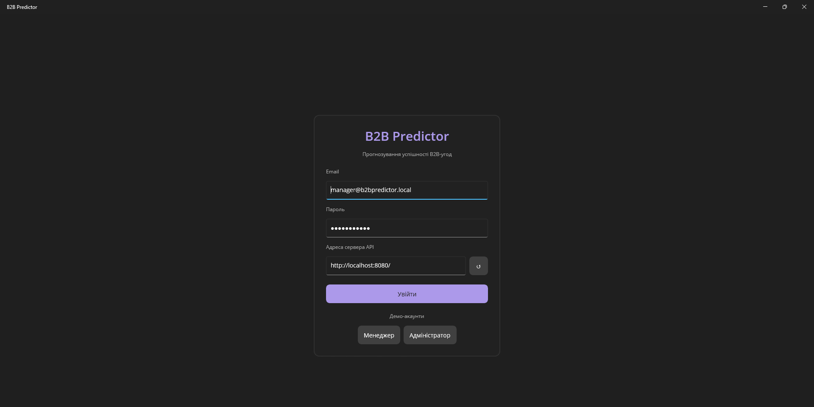
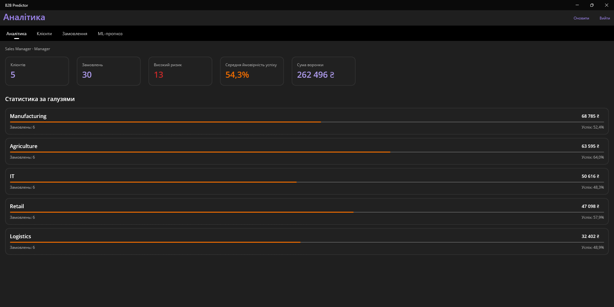
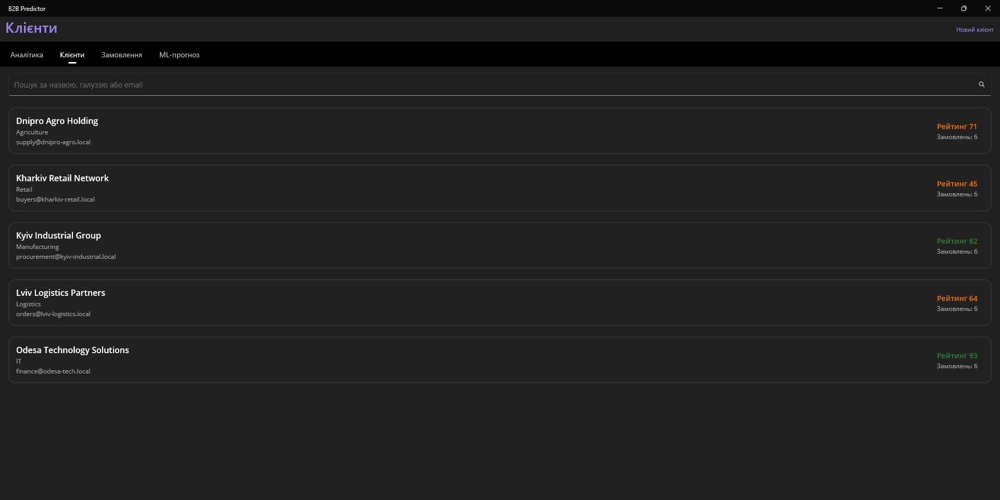
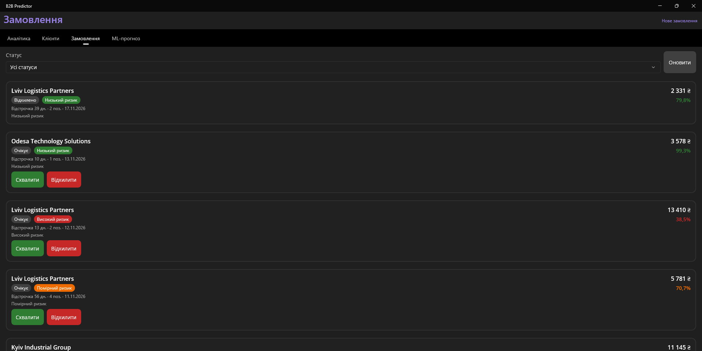
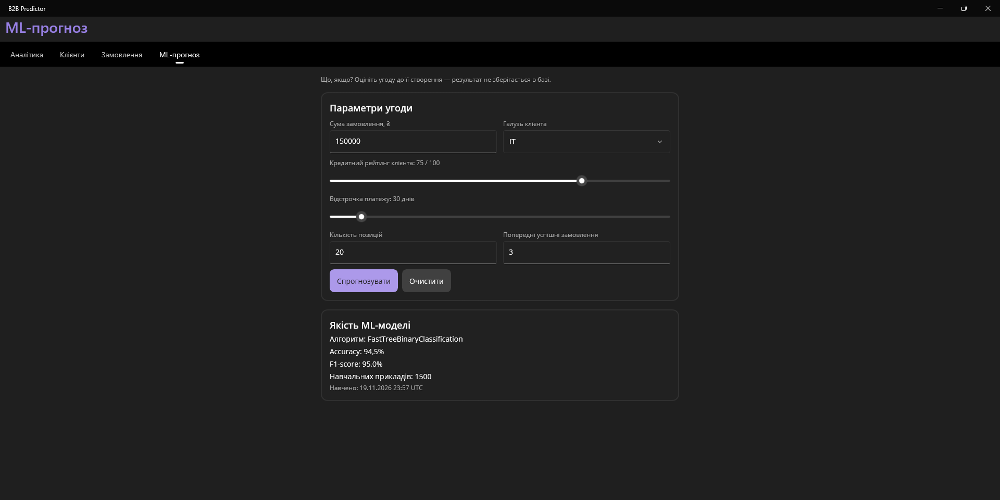
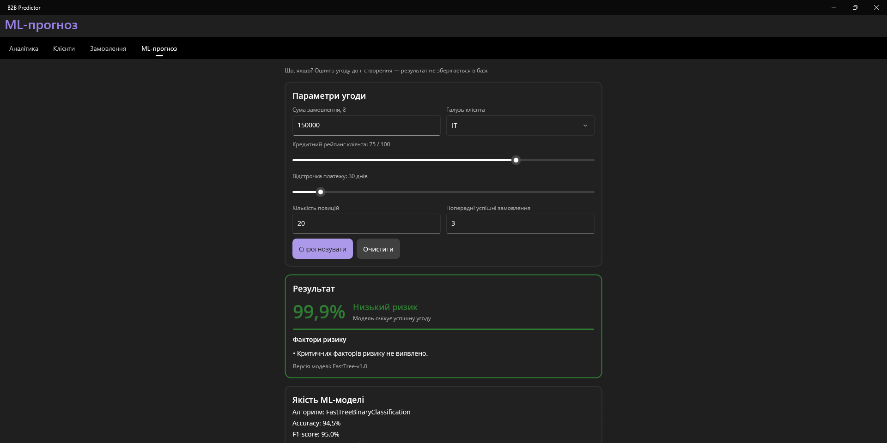

# B2BPredictor

**B2BPredictor** — навчальний мультиплатформний застосунок для прогнозування успішності B2B-замовлень. Система зберігає клієнтів і замовлення, рахує агреговану аналітику, прогнозує ймовірність успіху замовлення за допомогою ML.NET та показує результат у настільному застосунку .NET MAUI для Windows і в мобільному застосунку для Android.

> Статус: проєкт виконано в межах дисципліни «Мультиплатформне програмування». Це локальна документація до поточного стану репозиторію; вона не є інструкцією з розгортання в production.

## Зміст

- [Що вміє застосунок](#що-вміє-застосунок)
- [Технології](#технології)
- [Архітектура](#архітектура)
- [Швидкий старт: API + Windows](#швидкий-старт-api--windows)
- [Запуск Android-застосунку](#запуск-android-застосунку)
- [Запуск через Docker](#запуск-через-docker)
- [Тестові акаунти та seed-дані](#тестові-акаунти-та-seed-дані)
- [API](#api)
- [Тести, покриття та CI](#тести-покриття-та-ci)
- [Скріншоти](#скріншоти)
- [Структура репозиторію](#структура-репозиторію)
- [Конфігурація](#конфігурація)
- [Команда та внесок](#команда-та-внесок)
- [Обмеження](#обмеження)
- [Типові проблеми](#типові-проблеми)

## Що вміє застосунок

- JWT-автентифікація з ролями `Admin` і `Manager`.
- Перегляд, пошук, створення, редагування та видалення клієнтів (видалення — лише `Admin`).
- Створення замовлень з автоматичним прогнозом успішності.
- Пагінація, фільтрація та сортування замовлень.
- Зміна статусу замовлення: `Pending`, `Approved`, `Rejected`, `Completed`.
- Дашборд: кількість клієнтів і замовлень, кількість замовлень високого ризику, середня ймовірність успіху, сума pipeline та статистика за галузями.
- ML-прогноз `FastTree` з пояснюваними факторами ризику.
- Єдиний backend для Windows- і Android-клієнтів.
- SQLite-база з зовнішніми ключами, індексами та транзакційним створенням замовлення.
- Автоматичні unit- та integration-тести, покриття Coverlet, CI на GitHub Actions.

## Технології

| Шар | Технології |
|---|---|
| Backend | .NET 10, ASP.NET Core Web API, Entity Framework Core 9, SQLite |
| Автентифікація | JWT Bearer, PBKDF2 (100 000 ітерацій, SHA-256), ролі |
| ML | ML.NET 4.0, `FastTree` binary classification, synthetic dataset generator |
| UI | .NET MAUI 9, XAML, CommunityToolkit.Mvvm, typed `HttpClient` |
| Платформи UI | Windows 10/11 (WinUI 3), Android 5.0+ (API 21+) |
| Тести | xUnit, `Microsoft.AspNetCore.Mvc.Testing`, Coverlet |
| DevOps | Docker, Docker Compose, GitHub Actions |

## Архітектура

```text
┌──────────────────────────────┐       HTTP/JSON + JWT       ┌──────────────────────────────┐
│  B2BPredictor.UI (MAUI)      │ ──────────────────────────> │  B2BPredictor.Api            │
│  Windows / Android           │                             │  ASP.NET Core controllers    │
│  MVVM + typed ApiClient      │ <────────────────────────── │  JWT, ProblemDetails         │
└──────────────────────────────┘                             └──────────────┬───────────────┘
                                                                            │
                              ┌─────────────────────────────────────────────┼─────────────────────────────┐
                              │                                             │                             │
                    ┌─────────▼─────────┐                       ┌───────────▼──────────┐        ┌─────────▼─────────┐
                    │ Application       │                       │ Infrastructure       │        │ Domain            │
                    │ contracts,        │                       │ EF Core, SQLite,     │        │ entities, enums,  │
                    │ service interfaces│                       │ auth, ML, services   │        │ domain rules      │
                    └───────────────────┘                       └──────────────────────┘        └───────────────────┘
```

Основні проєкти:

- `B2BPredictor.Domain` — сутності `AppUser`, `Client`, `Order`, `OrderItem`, `PredictionHistory`, `PredictionRiskFactor` та enum-и.
- `B2BPredictor.Application` — DTO-контракти, інтерфейси сервісів, `ServiceResult`.
- `B2BPredictor.Infrastructure` — EF Core `DbContext`, конфігурації, міграція, seeder, JWT/PBKDF2, бізнес-сервіси, ML-сервіс.
- `B2BPredictor.Api` — REST-контролери, DI, health check, OpenAPI у Development.
- `B2BPredictor.UI` — MAUI-застосунок із Shell-навігацією та MVVM.
- `tests/B2BPredictor.UnitTests` — 37 unit-тестів.
- `tests/B2BPredictor.IntegrationTests` — 10 integration-тестів через `WebApplicationFactory`.

### Схема даних

Основні таблиці:

| Таблиця | Призначення |
|---|---|
| `Users` | Користувачі системи, хеш пароля, роль |
| `Clients` | B2B-клієнти, галузь, кредитний рейтинг |
| `Orders` | Замовлення, сума, термін оплати, статус, ймовірність успіху |
| `OrderItems` | Позиції замовлення (окрема таблиця, без масивів у `Orders`) |
| `PredictionHistory` | Історія прогнозів, модель, ймовірність, дата |
| `PredictionRiskFactors` | Пояснювальні фактори ризику для конкретного прогнозу |

Схема приведена до третьої нормальної форми: клієнти, замовлення, позиції замовлень і прогнози зберігаються окремо; зв'язки оформлені зовнішніми ключами; для полів пошуку/сортування створені індекси. Детальні конфігурації — у `src/B2BPredictor.Infrastructure/Persistence/Configurations`.

## Швидкий старт: API + Windows

### 1. Що потрібно встановити

- **Windows 10 версії 1809+ або Windows 11** (для WinUI 3).
- **.NET SDK 10.0** — перевірка: `dotnet --version`.
- **.NET MAUI workload**:
  ```powershell
  dotnet workload install maui
  ```
  Якщо потрібен лише Windows-таргет і в середовищі вже є Android/iOS workload, достатньо `dotnet workload install maui-windows`. Для Android — `maui-android`.
- **Windows App SDK runtime** зазвичай ставиться разом із Visual Studio або MAUI workload. Якщо застосунок не стартує з помилкою Windows App SDK, установіть актуальний Windows App Runtime.
- **Docker Desktop** — необов'язково, лише для запуску API в контейнері.

Перевірка workload:

```powershell
dotnet workload list
```

### 2. Запустити API

Відкрий **перше** вікно PowerShell у корені репозиторію:

```powershell
$env:Jwt__Key = "LocalDevOnlyJwtKey_For_UI_Testing_2026!"
$env:ASPNETCORE_URLS = "http://localhost:8080/"
dotnet run --project src/B2BPredictor.Api --no-launch-profile
```

На Linux/macOS:

```bash
export Jwt__Key="LocalDevOnlyJwtKey_For_UI_Testing_2026!"
export ASPNETCORE_URLS="http://localhost:8080/"
dotnet run --project src/B2BPredictor.Api --no-launch-profile
```

Перший запуск може зайняти до хвилини: створюється SQLite-база, виконується міграція, додаються seed-дані та навчається ML-модель. API готовий, коли в лозі з'явиться:

```text
Now listening on: http://localhost:8080/
```

Перевірка здоров'я:

```powershell
Invoke-WebRequest http://localhost:8080/healthz
# StatusCode: 200, Content: Healthy
```

> **Важливо:** ключ `Jwt__Key` має бути не коротшим за 32 байти. Значення вище призначене лише для локального запуску. Не використовуйте його в production і не комітьте справжні секрети.

За замовчуванням SQLite-файл `b2bpredictor.db` створюється в поточній робочій директорії процесу. Якщо не хочеш тримати базу в корені репозиторію, задай окремий шлях:

```powershell
$env:ConnectionStrings__Default = "Data Source=$env:LOCALAPPDATA\B2BPredictor\b2bpredictor.db;Foreign Keys=True"
```

Каталог для файлу має існувати. Для чистого запуску достатньо зупинити API і видалити локальний `.db`-файл — при наступному старті база й seed-дані створяться знову.

### 3. Запустити Windows-застосунок

Відкрий **друге** вікно PowerShell у корені репозиторію, не закриваючи перше:

```powershell
dotnet build src/B2BPredictor.UI/B2BPredictor.UI.csproj -t:Run -f net10.0-windows10.0.19041.0
```

Відкриється вікно **B2B Predictor**. На екрані входу вже підставлені:

- адреса API: `http://localhost:8080/`;
- email: `manager@b2bpredictor.local`;
- пароль: `Manager123!`.

Натисни **«Увійти»**. Після входу доступні вкладки **Аналітика**, **Клієнти**, **Замовлення**, **ML-прогноз**.

Якщо потрібно зібрати застосунок без запуску:

```powershell
dotnet build src/B2BPredictor.UI/B2BPredictor.UI.csproj -c Release -f net10.0-windows10.0.19041.0
```

Готовий `.exe` з'явиться у `src/B2BPredictor.UI/bin/Release/net10.0-windows10.0.19041.0/win-x64/`.

### 4. Перший сценарій перевірки

1. Увійти як `manager@b2bpredictor.local` / `Manager123!`.
2. Переконатися, що на дашборді є 5 клієнтів і 30 замовлень.
3. Відкрити **Клієнти** — перевірити пошук за назвою.
4. Відкрити **Замовлення** — перевірити пагінацію та статуси.
5. Відкрити **ML-прогноз** — натиснути **«Спрогнозувати»** та побачити ймовірність, ризик і фактори.
6. Вийти з акаунта і повторити вхід як `admin@b2bpredictor.local` / `Admin123!` — перевірити доступ до видалення.

## Запуск Android-застосунку

Android-таргет використовує той самий backend. У емуляторі адреса хоста — `10.0.2.2`, вона вже є стандартною для Android у `ApiEndpointSettings`.

### Підготовка

1. Встанови **.NET Android workload**:
   ```powershell
   dotnet workload install maui-android
   ```
2. Встанови **JDK 17** (наприклад, Microsoft OpenJDK 17) і задай `JAVA_HOME`.
3. Встанови **Android SDK**:
   - Platform: Android 36 (`platforms;android-36`);
   - Build-Tools: 36.0.0;
   - Platform-Tools;
   - Emulator та system image (наприклад, `system-images;android-36;google_apis;x86_64`).
4. Задай змінні середовища:
   ```powershell
   $env:JAVA_HOME = "C:\Program Files\Microsoft\jdk-17.0.x"
   $env:ANDROID_HOME = "$env:LOCALAPPDATA\Android\Sdk"
   $env:ANDROID_SDK_ROOT = $env:ANDROID_HOME
   ```
5. Запусти емулятор або підключи пристрій з увімкненим USB-debugging:
   ```powershell
   adb devices
   ```
6. API має бути запущений на хості на порту `8080`.

### Збірка та запуск

```powershell
dotnet build src/B2BPredictor.UI/B2BPredictor.UI.csproj `
  -t:Run `
  -f net10.0-android
```

Якщо потрібен лише APK:

```powershell
dotnet build src/B2BPredictor.UI/B2BPredictor.UI.csproj `
  -c Release `
  -f net10.0-android
```

APK з'явиться у `src/B2BPredictor.UI/bin/Release/net10.0-android/`.

> Android-манифест уже дозволяє cleartext HTTP для локальної розробки (`android:usesCleartextTraffic="true"`). Для production потрібно перейти на HTTPS і прибрати cleartext.

Якщо API запущений не на стандартному порту або потрібен фізичний пристрій, відкрий екран входу та зміни **адресу API** на:

- емулятор: `http://10.0.2.2:8080/`;
- фізичний пристрій: `http://<IP-комп'ютера>:8080/` (комп'ютер і телефон мають бути в одній мережі).

## Запуск через Docker

Docker-варіант піднімає лише API; MAUI-застосунок запускається окремо з Windows або Android.

```powershell
docker compose up --build
```

API буде доступний на `http://localhost:8080/`, дані зберігаються в named volume `b2bpredictor_data`. JWT-ключ за замовчуванням заданий у `docker-compose.yml`; для іншого ключа:

```powershell
$env:JWT_KEY = "MyLocalDockerJwtKey_AtLeast_32_Bytes!"
docker compose up --build
```

Перевірка:

```powershell
Invoke-WebRequest http://localhost:8080/healthz
```

Зупинка:

```powershell
docker compose down
```

Видалити контейнер разом із даними:

```powershell
docker compose down -v
```

> Docker Desktop має бути запущений. Якщо Docker недоступний, використовуй локальний запуск API з розділу вище.

## Тестові акаунти та seed-дані

Після першого запуску створюються два користувачі:

| Роль | Email | Пароль |
|---|---|---|
| Admin | `admin@b2bpredictor.local` | `Admin123!` |
| Manager | `manager@b2bpredictor.local` | `Manager123!` |

Seed-дані містять **5 клієнтів** і **30 замовлень** у галузях Manufacturing, Logistics, IT, Retail, Agriculture. На дашборді після чистого запуску відображаються:

- 5 клієнтів;
- 30 замовлень;
- 13 замовлень високого ризику;
- середня ймовірність успіху — близько 54,3%;
- сума pipeline — близько 262 496 ₴.

ML-модель навчається на синтетичному датасеті з 1500 записів; у поточному запуску метрики становлять приблизно **94,5% accuracy** і **95,0% F1**. Точні значення завжди можна отримати з `GET /api/predictions/metrics`.

## API

Базова адреса: `http://localhost:8080`. Формат — JSON. Усі захищені запити потребують заголовка:

```http
Authorization: Bearer <accessToken>
```

### Автентифікація

| Метод | Шлях | Доступ | Опис |
|---|---|---|---|
| `POST` | `/api/auth/register` | анонімно | Реєстрація користувача |
| `POST` | `/api/auth/login` | анонімно | Вхід, повертає JWT |
| `GET` | `/api/auth/profile` | авторизований | Профіль поточного користувача |

Приклад входу:

```powershell
$login = Invoke-RestMethod `
  -Method Post `
  -Uri http://localhost:8080/api/auth/login `
  -ContentType "application/json" `
  -Body '{"email":"manager@b2bpredictor.local","password":"Manager123!"}'

$headers = @{ Authorization = "Bearer $($login.accessToken)" }
$login | Format-List
```

### Клієнти

| Метод | Шлях | Доступ | Опис |
|---|---|---|---|
| `GET` | `/api/clients?search=&sortBy=name` | авторизований | Список клієнтів |
| `GET` | `/api/clients/{id}` | авторизований | Один клієнт |
| `POST` | `/api/clients` | авторизований | Створити клієнта |
| `PUT` | `/api/clients/{id}` | авторизований | Оновити клієнта |
| `DELETE` | `/api/clients/{id}` | **Admin** | Видалити клієнта |

Приклад створення:

```powershell
$client = Invoke-RestMethod `
  -Method Post `
  -Uri http://localhost:8080/api/clients `
  -Headers $headers `
  -ContentType "application/json" `
  -Body '{"name":"Demo Retail","industry":"Retail","contactEmail":"demo@retail.local","creditRating":75}'
```

Допустимий `creditRating` — від 1 до 100.

### Замовлення

| Метод | Шлях | Доступ | Опис |
|---|---|---|---|
| `GET` | `/api/orders?page=1&pageSize=20&status=1&clientId={id}&sortBy=-createdAt` | авторизований | Список із пагінацією |
| `GET` | `/api/orders/{id}` | авторизований | Одне замовлення |
| `POST` | `/api/orders` | авторизований | Створити замовлення + ML-прогноз |
| `PATCH` | `/api/orders/{id}/status` | авторизований | Змінити статус |
| `PUT` | `/api/orders/{id}/status` | авторизований | Те саме (сумісність) |
| `DELETE` | `/api/orders/{id}` | **Admin** | Видалити замовлення |

Статуси в JSON передаються числами: `0` — Pending, `1` — Approved, `2` — Rejected, `3` — Completed.

Приклад створення:

```powershell
$order = Invoke-RestMethod `
  -Method Post `
  -Uri http://localhost:8080/api/orders `
  -Headers $headers `
  -ContentType "application/json" `
  -Body (@{
      clientId = $client.id
      amount = 125000
      paymentTermsDays = 30
      itemsCount = 4
      notes = "Demo order"
    } | ConvertTo-Json)

$order | Format-List
```

Приклад зміни статусу:

```powershell
Invoke-RestMethod `
  -Method Patch `
  -Uri "http://localhost:8080/api/orders/$($order.id)/status" `
  -Headers $headers `
  -ContentType "application/json" `
  -Body '{"status":1,"notes":"Approved by manager"}'
```

### Аналітика та ML

| Метод | Шлях | Доступ | Опис |
|---|---|---|---|
| `GET` | `/api/analytics/summary` | авторизований | Зведені показники дашборда |
| `POST` | `/api/predictions/preview` | авторизований | Прогноз без збереження замовлення |
| `GET` | `/api/predictions/metrics` | авторизований | Метрики ML-моделі |
| `GET` | `/healthz` | анонімно | Health check |

Приклад прогнозу:

```powershell
Invoke-RestMethod `
  -Method Post `
  -Uri http://localhost:8080/api/predictions/preview `
  -Headers $headers `
  -ContentType "application/json" `
  -Body '{"amount":125000,"industry":"Retail","clientCreditRating":75,"paymentTermsDays":30,"itemsCount":4,"previousSuccessfulOrdersCount":12}'
```

### Коди помилок

| Код | Коли виникає |
|---|---|
| `400` | Помилка валідації DTO, некоректні межі, невідомий enum |
| `401` | Немає токена або токен недійсний |
| `403` | Недостатньо прав (наприклад, Manager намагається видалити) |
| `404` | Клієнта або замовлення не знайдено |
| `409` | Конфлікт даних (наприклад, email уже зайнятий) |
| `500` | Неочікувана серверна помилка; API повертає `ProblemDetails` |

## Тести, покриття та CI

### Локальний запуск тестів

```powershell
dotnet test tests/B2BPredictor.UnitTests/B2BPredictor.UnitTests.csproj -c Release
dotnet test tests/B2BPredictor.IntegrationTests/B2BPredictor.IntegrationTests.csproj -c Release
```

Фактичний результат на останній перевірці:

| Набір | Тестів | Результат |
|---|---:|---|
| Unit | 37 | 37 passed, 0 failed |
| Integration | 10 | 10 passed, 0 failed |
| **Разом** | **47** | **47 passed, 0 failed** |

### Покриття

```powershell
dotnet test tests/B2BPredictor.UnitTests/B2BPredictor.UnitTests.csproj `
  -c Release `
  --collect:"XPlat Code Coverage" `
  --results-directory artifacts/coverage-unit

dotnet test tests/B2BPredictor.IntegrationTests/B2BPredictor.IntegrationTests.csproj `
  -c Release `
  --collect:"XPlat Code Coverage" `
  --results-directory artifacts/coverage-integration
```

Об'єднання звітів через ReportGenerator:

```powershell
dotnet tool install --global dotnet-reportgenerator-globaltool --version 5.4.4
reportgenerator `
  -reports:"artifacts/coverage-unit/**/coverage.cobertura.xml;artifacts/coverage-integration/**/coverage.cobertura.xml" `
  -targetdir:artifacts/coverage-merged `
  -reporttypes:"Html;TextSummary;Cobertura" `
  -assemblyfilters:"+B2BPredictor.*" `
  -classfilters:"-*Migrations*"
```

Фактичний результат об'єднаного звіту (20.11.2026):

| Показник | Значення |
|---|---:|
| Line coverage | **83.9%** (1087 / 1295) |
| Branch coverage | 56.4% (175 / 310) |
| Method coverage | 82.8% (217 / 262) |
| Покрито рядків | 1087 |
| Не покрито рядків | 208 |

Покриття по збірках: `B2BPredictor.Infrastructure` — 89.6%, `B2BPredictor.Domain` — 84.7%, `B2BPredictor.Application` — 82.3%, `B2BPredictor.Api` — 52.6%.

> Область вимірювання — **backend-збірки** `Api`, `Application`, `Domain`, `Infrastructure`. MAUI UI не входить у Coverlet-звіт, оскільки UI-автотестів у проєкті немає. Міграції виключені з підсумкового звіту. Це не «покриття всього репозиторію», а покриття бекенду, яке перевіряється unit- та integration-тестами.

### CI

Workflow `.github/workflows/ci.yml` на кожен push/PR у `main`:

1. відновлює backend-залежності;
2. збирає API, unit- та integration-проєкти в Release з аналізаторами;
3. запускає обидва набори тестів із Coverlet;
4. завантажує `coverage.cobertura.xml` як artifact.

Станом на останню перевірку всі 7 видимих запусків `B2BPredictor CI` завершилися успішно; останній — run `#44626159035` для commit `20426e4` (гілка `main`).

### Статичний аналіз

`Directory.Build.props` вмикає `TreatWarningsAsErrors=true` та `AnalysisLevel=latest-recommended`. Перевірка:

```powershell
dotnet build src/B2BPredictor.Api/B2BPredictor.Api.csproj -c Release -p:RunAnalyzers=true
dotnet build tests/B2BPredictor.UnitTests/B2BPredictor.UnitTests.csproj -c Release -p:RunAnalyzers=true
dotnet build tests/B2BPredictor.IntegrationTests/B2BPredictor.IntegrationTests.csproj -c Release -p:RunAnalyzers=true
```

Очікуваний результат — `0 Warning(s)`, `0 Error(s)`. Саме ці команди використовуються в CI.

## Скріншоти

Усі скріншоти зроблені з локально запущеного застосунку на commit `20426e4` (Windows 11, клієнт .NET MAUI; API — локальний SQLite + seed-дані).

### Windows

| Екран входу | Дашборд |
|---|---|
|  |  |

| Клієнти | Замовлення |
|---|---|
|  |  |

| ML-прогноз | Результат прогнозу |
|---|---|
|  |  |

### Android

Android-таргет збирається з того самого проєкту `B2BPredictor.UI`; для нього використовується адреса API `http://10.0.2.2:8080/` в емуляторі. Інструкція запуску — у розділі [Запуск Android-застосунку](#запуск-android-застосунку).

Фактичний доказ для звіту: signed APK успішно зібрано (15 804 093 байтів, 0 попереджень / 0 помилок, Android API 36). Runtime-скріншот Android не зафіксовано, оскільки емулятор не запустився без апаратної віртуалізації (Hyper-V/WHPX/AEHD); це обмеження описано у звіті.

## Структура репозиторію

```text
.
├── src/
│   ├── B2BPredictor.Api/              # REST API, контролери, Program.cs
│   ├── B2BPredictor.Application/      # контракти та інтерфейси сервісів
│   ├── B2BPredictor.Domain/           # сутності та enum-и
│   ├── B2BPredictor.Infrastructure/   # EF Core, auth, ML, бізнес-сервіси
│   └── B2BPredictor.UI/               # .NET MAUI (Windows + Android)
├── tests/
│   ├── B2BPredictor.UnitTests/
│   └── B2BPredictor.IntegrationTests/
├── docs/screenshots/                  # локальні скріншоти для README/звіту
├── .github/workflows/ci.yml
├── Dockerfile
├── docker-compose.yml
├── Directory.Build.props
├── Directory.Packages.props
└── B2BPredictor.slnx
```

## Конфігурація

| Змінна | Призначення | Приклад |
|---|---|---|
| `Jwt__Key` | Симетричний ключ JWT, ≥ 32 байти | `LocalDevOnlyJwtKey_For_UI_Testing_2026!` |
| `Jwt__Issuer` | Issuer токена | `B2BPredictor` |
| `Jwt__Audience` | Audience токена | `B2BPredictor.Client` |
| `Jwt__ExpiryMinutes` | Час життя токена | `60` |
| `ASPNETCORE_URLS` | Адреса API | `http://localhost:8080/` |
| `ConnectionStrings__Default` | Рядок підключення SQLite | `Data Source=b2bpredictor.db;Foreign Keys=True` |
| `ASPNETCORE_ENVIRONMENT` | Середовище | `Development` / `Production` |

У `Development` доступний OpenAPI: `http://localhost:8080/openapi/v1.json` (залежно від версії ASP.NET Core). У Production OpenAPI не мапиться.

## Команда та внесок

| GitHub | Студент | Основна зона відповідальності |
|---|---|---|
| `frotanis` | Будяк Данило Володимирович | Архітектура, контракти, REST API, аналітика, integration-тести, Docker/CI, review/merge |
| `nedeflexa` | Василець Олександр Миколайович | Схема 3НФ, EF Core, міграція, seeder, JWT/PBKDF2, транзакційні замовлення, `ClientService`, unit-тести |
| `PolinaKok` | Кокот Поліна Юріївна | Генератор ML-датасету, FastTree-модель, `PredictionService`, ML-тести, узгодження контрактів |
| `Anna-nya` | Русавська Анна Євгенівна | MAUI Shell, сторінки, ViewModels, типізований API-клієнт, MVVM-фундамент |

Детальніший розподіл за блоками, хронологія та рев'ю — у звіті `B2BPredictor_MPP_Report.docx`.

## Обмеження

- **iOS і MacCatalyst** оголошені в `TargetFrameworks`, але потребують macOS + Xcode; на Windows-машині вони не запускалися.
- **Android** потребує встановленого Android SDK, JDK 17 та емулятора/пристрою; без них доступна лише компіляція за наявності workload.
- **Docker** локально не перевірявся, якщо Docker Desktop не встановлений; інструкція відповідає `Dockerfile` і `docker-compose.yml` у репозиторії.
- SQLite — навчальний вибір; для production потрібні міграції під PostgreSQL/SQL Server, секрети поза репозиторієм і HTTPS.
- ML-модель навчається на синтетичних даних; це демонстрація архітектури, а не production-прогноз.
